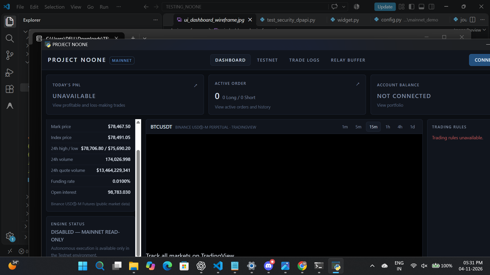
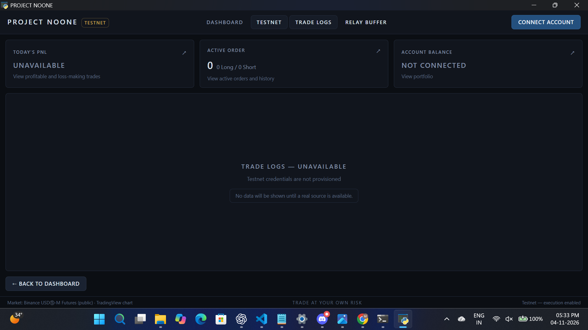
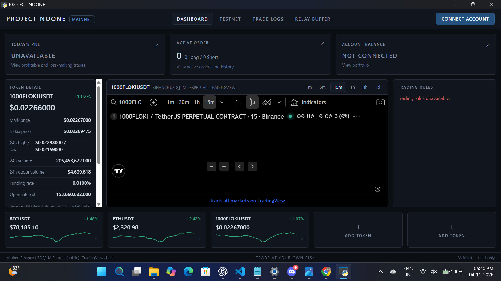
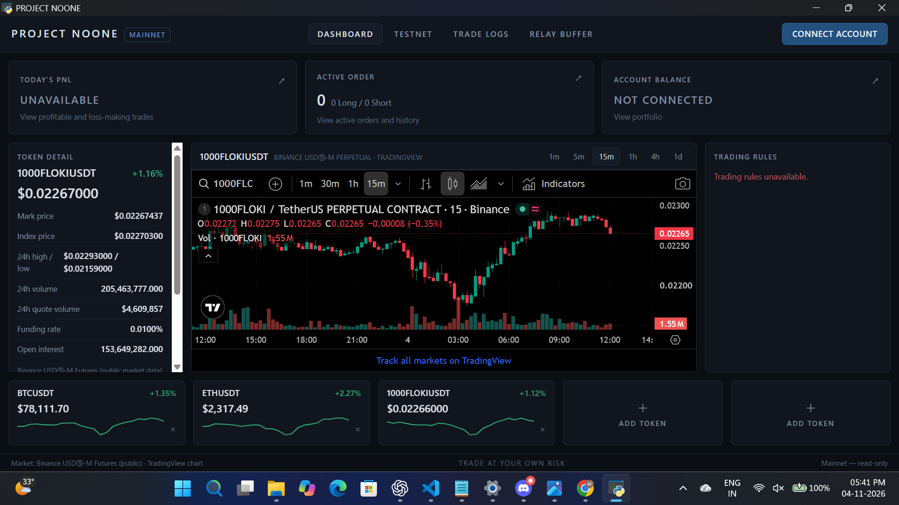

# PROJECT NOONE

[](LICENSE)
[](https://github.com/)
[](https://www.python.org/)

**PROJECT NOONE** is an autonomous cryptocurrency perpetual-futures trading application built with a modern desktop UI, local CPU reinforcement learning engine, real-time market and news sentiment analytics, strict risk gating, and hardware-bound credential security.

Designed for efficiency and predictability, PROJECT NOONE runs locally without requiring expensive cloud GPUs or third-party paid LLM APIs.

---

## Table of Contents

1. [Project Overview](#project-overview)
2. [Implemented Features](#implemented-features)
3. [Screenshots](#screenshots)
4. [Architecture & Technology Stack](#architecture--technology-stack)
5. [System Data Flow](#system-data-flow)
6. [Windows x64 Installation & Running](#windows-x64-installation--running)
7. [Exchange Account Setup](#exchange-account-setup)
8. [Supported Exchanges & Environments](#supported-exchanges--environments)
9. [Risk Controls & Trading Safety](#risk-controls--trading-safety)
10. [Security & Credential Management](#security--credential-management)
11. [Development Setup](#development-setup)
12. [Project Layout](#project-layout)
13. [Known Limitations](#known-limitations)
14. [License](#license)
15. [Financial Risk Disclaimer](#financial-risk-disclaimer)

---

## Project Overview

PROJECT NOONE delivers a local, autonomous trading station for perpetual futures. It bridges the gap between machine learning research and desktop trading by integrating:

- High-throughput market data ingestion from Binance USDⓈ-M Futures (REST & WebSockets).
- Free financial news collection with deterministic sentiment classification using a domain-tuned FinVADER model.
- Gymnasium-compatible simulation environment enforcing strict anti-lookahead mechanics and Binance fee/funding rules.
- Local CPU-trained Deep Q-Network (DQN) policy engine.
- Fail-closed execution gate with idempotent 9-step order recovery.
- Native Windows desktop application with interactive TradingView charting and real-time telemetry.

---

## Implemented Features

### Component 1 — Reinforcement Learning & Inference Engine (`src/noone/rl_engine`)
- **Stage 1 Gymnasium Adapter**: `NooneGymEnv` wraps the perpetual futures simulation (`Component 8`) into standard Gymnasium spaces: `Box(26,)` observation space and `Discrete(5)` action space (`0: HOLD`, `1: OPEN_LONG`, `2: CLOSE_LONG`, `3: OPEN_SHORT`, `4: CLOSE_SHORT`).
- **Unified FeatureBuilder**: 26 canonical features (12 market dynamics, 8 account state indicators, 6 sentiment attributes) clipped to `[-10, 10]` with zero-fabrication guarantees.
- **Stage 2 Local CPU DQN Pipeline**: Stable-Baselines3 compatible DQN pipeline with custom exploration schedules, linear epsilon decay, reward scaling, and cryptographic model metadata verification.
- **Model Inference**: Real-time evaluation engine consuming live market and news buffers to produce directional predictions with confidence metrics.

### Component 2 — News Classifier & Asset Identification (`src/noone/news_classifier`)
- **Modified Lexicon FinVADER**: Combines NLTK VADER with financial lexicons (SentiBignomics and Henry) topped with an extensive cryptocurrency-specific overlay (`bullish`, `bearish`, `liquidation`, `exploit`, `halving`, etc.).
- **Deterministic Asset Tagger**: Extracts cryptocurrency assets (BTC, ETH, SOL, etc.) with contextual disambiguation (e.g., verifying crypto context before attributing ambiguous tickers like `SOL`, `NEAR`, or `OP`).
- **Impact Proximity Heuristic**: Flags assets as explicitly `affected` only when high-impact directional verbs appear within a 5-token window in the same sentence.

### Component 3 — Execution Engine & Risk Gate (`src/noone/exchange`)
- **Exchange Orchestrator**: Manages execution state machine, lifecycle tracking, order placement, and live position tracking via CCXT.
- **Fail-Closed 9-Step Reconciliation**: Authoritative post-order reconciliation resolving fills, partials, timeouts, and network disconnects without ambiguous state.
- **Pre-Dispatch Risk Gate**: Validates order notional limits, account leverage caps, maintenance margins, and daily drawdown boundaries before any order reaches the exchange adapter.

### Component 4 — Market Real-Time & News Data APIs (`src/noone/market_data`, `src/noone/news_data`)
- **Binance Futures REST & WebSocket**: Native client for Binance USDⓈ-M Futures (`/fapi/v1/klines`, `/fapi/v1/fundingRate`, and `wss://fstream.binance.com/market`) with backoff rate-limit handling and automatic heartbeat resubscription.
- **Point-in-Time Historical Paginator**: Comprehensive kline and funding history paginators with duplicate-record purging, timestamp boundary probing, gap identification, and two-sided interval anomaly detection.
- **Point-in-Time News Archive**: Local SQLite archive (`NewsArchive`) persisting real-time crypto news with immutable `published_at`, `first_seen_at`, and `retrieved_at` timestamps to prevent data leakage.

### Component 5 — Interactive Chart Widget (`src/noone/chart`)
- **TradingView Advanced Chart**: Embedded real-time financial chart supporting technical indicators, interval selection (1m, 5m, 15m, 1h, 4h, 1D), dark mode styling, and responsive layout matching the application theme.

### Component 6 — Desktop User Interface (`src/noone/ui`, `frontend/`)
- **Native PyWebView Container**: Lightweight desktop window powered by Microsoft Edge WebView2 (no heavy Chromium wrapper).
- **Modern Responsive Dashboard**: React 18 + Tailwind CSS frontend featuring 6 primary functional sections:
  1. **Market Overview & Live Charting**: Live ticker feeds, order book depth, and interactive TradingView integration.
  2. **Account Balances & Positions**: Real-time unrealized/realized PnL, margin utilization, liquidation price estimates, and position tracking.
  3. **Order Placement & Execution**: Market and limit order dispatch with client-side boundary safety checks.
  4. **News Sentiment Feed**: Real-time streaming news headlines, sentiment classification bars, and asset tag breakdown.
  5. **Model Telemetry & Diagnostics**: Model inference monitor, policy action outputs, and system latency metrics.
  6. **Security & Credentials**: Local API key management, status indicators, and permission verification.
- **Loopback IPC Server**: Hardened local HTTP backend listening strictly on `127.0.0.1` protected by dynamic session tokens (`X-NOONE-Token`).

### Component 7 — Security & DPAPI Storage (`src/noone/security`)
- **Zero Plaintext Credentials**: All exchange API keys and secrets are encrypted via Windows Data Protection API (`CryptProtectData`), bound to the local Windows user profile.
- **No Remote Transmission**: Credentials never touch cloud servers, logging pipelines, or third-party analytics.

### Component 8 — Perpetual Futures Simulation Environment (`src/noone/trading_env`)
- **Closed-Candle Simulation**: Accurate backtesting and gym environment simulating adverse slippage, taker fees, realistic liquidation boundaries, and scheduled 8-hour funding settlements.

---

## Screenshots

The desktop UI provides a unified workstation across all 6 core trading functions:

| Live Trading & Real-Time Charting | Account & Position Monitoring |
|:---:|:---:|
|  |  |

| News Sentiment & Market Ingestion | Model Diagnostics & Strategy State |
|:---:|:---:|
|  |  |

---

## Architecture & Technology Stack

```
┌─────────────────────────────────────────────────────────────┐
│                      PROJECT NOONE UI                       │
│          (PyWebView Desktop Shell + React / Vite / Tailwind) │
└──────────────────────────────┬──────────────────────────────┘
                               │ Local HTTP / WebSocket (127.0.0.1)
                               │ Authenticated via X-NOONE-Token
┌──────────────────────────────▼──────────────────────────────┐
│                  NOONE Backend Core (Bottle)                │
├───────────────┬─────────────────────────────┬───────────────┤
│ Component 2   │ Component 1                 │ Component 3   │
│ News Classifier│ RL Inference & Features    │ Risk Gate &   │
│ (FinVADER)    │ (Gymnasium / SB3 / PyTorch) │ Execution     │
├───────────────┼─────────────────────────────┼───────────────┤
│ Component 4   │ Component 7                 │ Component 8   │
│ Market Data   │ Security & DPAPI            │ Simulation    │
│ (REST / WS)   │ (CryptProtectData)          │ Environment   │
└───────────────┴─────────────────────────────┴───────────────┘
```

- **Backend Runtime**: Python 3.12 (64-bit)
- **Frontend Framework**: React 18, TypeScript, Tailwind CSS, Vite
- **Desktop Shell**: PyWebView 6.2+ (Microsoft Edge WebView2 runtime)
- **Machine Learning**: PyTorch (CPU-only), Stable-Baselines3, Gymnasium, NumPy
- **Exchange Integration**: CCXT, HTTPX, WebSockets
- **Natural Language Processing**: NLTK, Modified FinVADER
- **Security**: Windows DPAPI (`ctypes.windll.crypt32`)

---

## System Data Flow

1. **Market & News Acquisition**:
   - `BinanceFuturesCollector` pulls kline updates and streams real-time trades/mark prices via `wss://fstream.binance.com/market`.
   - `CryptoNewsCollector` fetches fresh headlines, normalizes metadata, and writes to `NewsArchive` with strict point-in-time timestamps (`published_at`, `first_seen_at`).
2. **Sentiment & Feature Assembly**:
   - `FinVADERClassifier` evaluates incoming articles for compound sentiment and maps crypto asset mentions.
   - `FeatureBuilder` extracts a canonical 26-dimension vector combining recent market returns, volatility, account state, and fresh news signals.
3. **Model Evaluation**:
   - `ModelInference` evaluates the observation vector using the trained DQN weights to select the optimal trading action (`HOLD`, `OPEN_LONG`, `CLOSE_LONG`, `OPEN_SHORT`, `CLOSE_SHORT`).
4. **Safety & Execution**:
   - Any proposed trade passes through `RiskGate` (checking daily loss threshold, leverage limits, and isolated margin rules).
   - If approved, `ExchangeOrchestrator` places the order via CCXT on Binance Futures Testnet and conducts 9-step fail-closed reconciliation.
5. **State Broadcast**:
   - Live positions, balances, trades, and logs are synchronized to `UIStateStore` and reflected immediately on the React dashboard.

---

## Windows x64 Installation & Running

PROJECT NOONE is distributed as a self-contained portable Windows x64 application:

### Quick Start (Standalone Release)
1. Download `PROJECT-NOONE-Windows-x64.zip` from the release assets.
2. Extract the ZIP archive to a folder on your system (e.g., `C:\Apps\PROJECT-NOONE`).
3. Ensure the extracted directory structure is maintained:
   ```
   PROJECT-NOONE-Windows-x64/
   ├── NOONE.exe
   └── _internal/
   ```
4. Double-click **`NOONE.exe`** to launch the desktop trading interface.

> **Note**: Because this application is compiled locally without an expensive commercial code-signing certificate, Windows SmartScreen may show an "Unrecognized app" prompt on first launch. Click **More info** → **Run anyway**.

---

## Exchange Account Setup

To connect to Binance Futures:

1. Open the desktop application and click the **Security / Settings** tab in the sidebar.
2. In the **Exchange Credentials** section:
   - Select the target environment (**Testnet**).
   - Enter your **Binance Futures API Key** and **Secret Key**.
3. Click **Save & Encrypt Credentials**.
4. The application encrypts keys using Windows DPAPI and saves them to:
   ```
   %LOCALAPPDATA%\NOONE\credentials_testnet.enc
   ```
5. You can test your connection or delete stored credentials at any time from the UI.

---

## Supported Exchanges & Environments

| Integration | Protocol / Engine | Environment | Status |
|---|---|---|---|
| **Binance USDⓈ-M Futures** | REST (`/fapi/v1/`) | Testnet / Demo | **Fully Implemented** |
| **Binance USDⓈ-M Futures** | WebSocket (`/market`) | Testnet / Public | **Fully Implemented** |
| **Binance USDⓈ-M Futures** | CCXT Adapter | Live Production Mainnet | **HARD LOCKED (Blocked)** |

> ### Important: Mainnet Trading Execution is Hard Locked
> In accordance with fail-closed safety design, **all live Mainnet order execution and balance mutations are intentionally disabled via hard code assertion locks (`ExchangeError: PRODUCTION EXECUTION HARD LOCKED`)**. Live production capital cannot be risked. All interactive trading operates exclusively within the **Binance Futures Testnet** environment.

---

## Risk Controls & Trading Safety

The engine implements multiple layers of defensive risk management:

- **Isolated Margin Only**: Cross-margin mode is strictly rejected to prevent shared collateral liquidation.
- **Leverage Invariants**: Max leverage is strictly capped (1x for standard demonstration, max 3x ceiling).
- **Mandatory Daily Loss Limit**: Tracks cumulative daily PnL across UTC midnight boundaries. If the configured daily loss threshold is hit, all open positions are liquidated immediately, and all trading is halted for the remainder of the session.
- **Fail-Closed Safety Freeze**: If order status cannot be determined due to network dropouts or exchange errors, a system-wide freeze activates, blocking new orders until manual intervention or state recovery succeeds.
- **Idempotent Client Order IDs**: Every order generation produces a cryptographically deterministic UUID prevents duplicate execution on network retry.

---

## Security & Credential Management

- **Hardware/User-Bound Encryption**: Windows DPAPI (`CryptProtectData`) encrypts credentials using a cryptographic key derived from the user's Windows login hash and TPM/hardware entropy.
- **Zero Plaintext Storage**: Plaintext keys are never written to disk, included in application logs, or cached in browser local storage.
- **Sandboxed Loopback IPC**: The desktop UI and backend communicate exclusively over `127.0.0.1` using short-lived bearer tokens (`X-NOONE-Token`). No external ports are exposed.
- **No Remote Telemetry**: PROJECT NOONE does not include telemetry, tracking analytics, or remote monitoring backdoors.

---

## Development Setup

If you wish to build, develop, or run the project from source:

### Prerequisites
- Python 3.12 (64-bit)
- Node.js 18+ and npm
- Windows 10/11 x64

### 1. Clone & Set Up Python Environment
```powershell
git clone <repository-url>
cd PROJECT-NOONE

# Create and activate virtual environment
python -m venv .venv
.\.venv\Scripts\Activate.ps1

# Install project and development dependencies
pip install -e ".[dev]"

# Install FinVADER lexicon support
pip install --no-deps --ignore-requires-python finvader
```

### 2. Set Up Frontend
```powershell
cd frontend
npm install
npm run build
cd ..
```

### 3. Unified Development Runner
PROJECT NOONE includes an automated concurrent development runner (`run_dev.py`):
```powershell
python run_dev.py
```
This utility:
- Detects and clears any stale processes on ports `8765` and `5173`.
- Launches the Python backend in development mode with unbuffered output.
- Concurrently launches the Vite frontend server with hot-module replacement.
- Handles clean shutdown across both process trees upon `Ctrl+C`.

### 4. Running Test Suite
```powershell
# Run all offline unit tests
python -m pytest tests -m "not live"

# Run live network integration tests (optional)
$env:NOONE_LIVE=1; python -m pytest tests/test_live.py -v
```

---

## Project Layout

```
PROJECT-NOONE/
├── frontend/                     # React + Vite + Tailwind desktop frontend
│   ├── src/                      # UI components, state store, hooks, API clients
│   ├── package.json              # Frontend dependencies and build scripts
│   └── vite.config.ts            # Vite bundler configuration
├── src/
│   └── noone/
│       ├── chart/                # Component 5: TradingView chart widget
│       ├── exchange/             # Component 3: CCXT orchestrator & risk gate
│       ├── mainnet_demo/         # Mainnet demo client & safety assertion boundary
│       ├── market_data/          # Component 4: Binance Futures REST & WebSocket
│       ├── news_classifier/      # Component 2: FinVADER NLP & asset mapping
│       ├── news_data/            # Component 4: News collector & SQLite archive
│       ├── rl_engine/            # Component 1: Gymnasium env, DQN & inference
│       ├── security/             # Component 7: Windows DPAPI encryption
│       ├── trading_env/          # Component 8: Closed-candle simulation
│       └── ui/                   # Component 6: Desktop PyWebView launcher & server
├── tests/                        # Comprehensive unit & integration test suite
├── runs/                         # Pre-trained DQN model checkpoints & evaluations
├── noone.spec                    # PyInstaller x64 build specification
├── run_dev.py                    # Unified concurrent development runner
├── pyproject.toml                # Project metadata & Python dependencies
├── LICENSE                       # MIT License
└── README.md                     # Project documentation
```

---

## Known Limitations

- **Operating System**: Standalone desktop executable and DPAPI encryption require Windows 10/11 (64-bit).
- **Single Trading Pair**: Current RL observation pipeline and feature extraction are optimized for `BTCUSDT` perpetual contracts.
- **Single Position**: The execution engine enforces a single open position at any given time (no multi-position hedging).
- **CPU Execution**: Model training and evaluation run entirely on CPU architectures; GPU/CUDA acceleration is intentionally omitted to maximize local hardware compatibility.
- **Mainnet Order Execution**: Real money mainnet execution is locked by design.

---

## License

This project is licensed under the **MIT License**. See the [LICENSE](LICENSE) file for details.

*Third-Party Notice*: Portions of this project incorporate FinVADER lexicon modules, which are licensed under Apache-2.0. All other dependencies remain subject to their respective upstream licenses.

---

## Financial Risk Disclaimer

> **PLEASE READ CAREFULLY BEFORE USING THIS SOFTWARE:**
>
> 1. **Educational & Research Purpose Only**: PROJECT NOONE is provided solely for educational, academic, and software development research. Nothing contained within this software, documentation, or code constitutes financial, investment, legal, or tax advice.
> 2. **High-Risk Activity**: Cryptocurrency perpetual futures trading involves extreme volatility, substantial market risk, and potential total loss of capital. Automated trading algorithms may encounter unforeseen network latency, exchange API outages, slippage, or logic discrepancies.
> 3. **No Warranties or Profit Guarantees**: This software is provided "AS IS", without warranty of any kind, express or implied. Neither the developers nor contributors guarantee profits, error-free operation, or protection against financial loss.
> 4. **User Responsibility**: Users assume full and exclusive responsibility for verifying the software's behavior, configuring safety thresholds, and complying with all applicable financial regulations.
